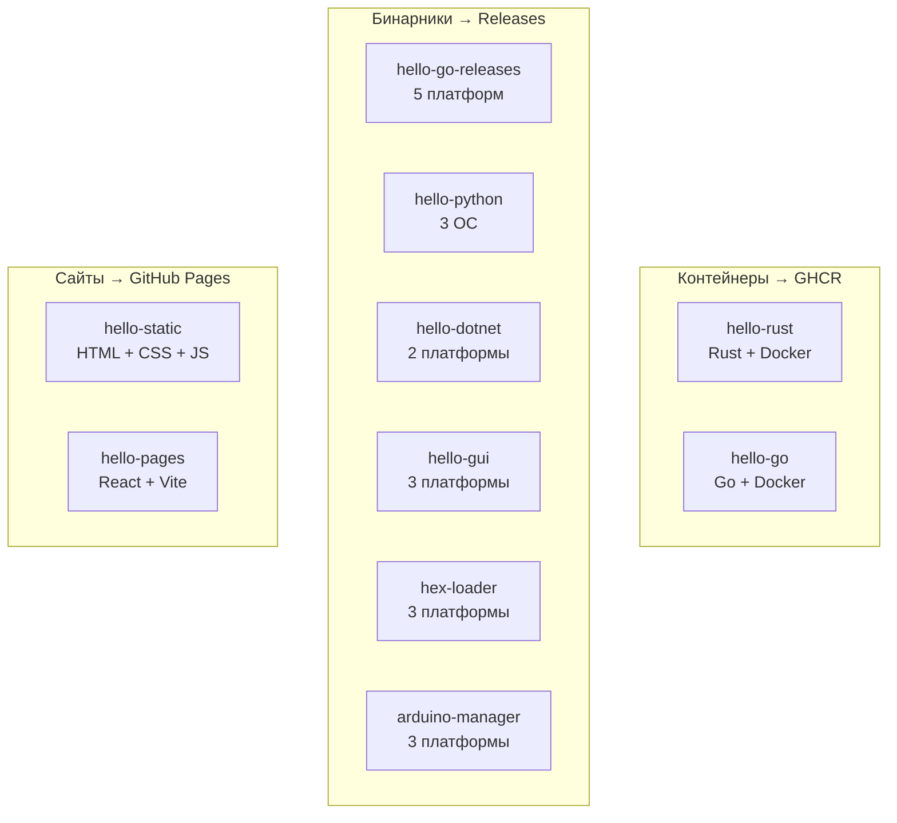

# CI/CD пайплайны — индекс заданий

Здесь лежит только индекс. Каждое учебное задание — **отдельный
репозиторий** со своим пайплайном, своим стеком и своей публикацией.
Код между ними не переиспользуется: одно задание не должно зависеть от
другого.

---

## Задания

| # | Задание | Стек | Что публикует | Триггер |
|:-:|---|---|---|---|
| 1 | [hello-rust](https://github.com/SpleIII/hello-rust) | Rust + Docker | образ в GHCR | push в `main` |
| 2 | [hello-go](https://github.com/SpleIII/hello-go) | Go + Docker | образ в GHCR | push в `main` |
| 3 | [hello-go-releases](https://github.com/SpleIII/hello-go-releases) | Go | бинарники (5 платформ) | тег `v*` |
| 4 | [hello-python](https://github.com/SpleIII/hello-python) | Python + PyInstaller | бинарники (3 ОС) | тег `v*` |
| 5 | [hello-dotnet](https://github.com/SpleIII/hello-dotnet) | C# / .NET 8 | бинарники (2 платформы) | тег `v*` |
| 6 | [hello-gui](https://github.com/SpleIII/hello-gui) | Go + Fyne | бинарники (3 платформы) | тег `v*` |
| 7 | [hex-loader](https://github.com/SpleIII/hex-loader) | Go + Fyne | бинарники (3 платформы) | тег `v*` |
| 8 | [arduino-manager](https://github.com/SpleIII/arduino-manager) | Go + Fyne | бинарники (3 платформы) | тег `v*` |
| 9 | [hello-static](https://github.com/SpleIII/hello-static) | HTML + CSS + JS | сайт на GitHub Pages | push в `main` |
| 10 | [hello-pages](https://github.com/SpleIII/hello-pages) | React + Vite | SPA на GitHub Pages | push в `main` |

### Живые ссылки

| Что | Адрес |
|---|---|
| Статический сайт | <https://spleiii.github.io/hello-static/> |
| React SPA | <https://spleiii.github.io/hello-pages/> |
| Образы в GHCR | `ghcr.io/spleiii/hello-rust`, `ghcr.io/spleiii/hello-go` |
| Релизы | [Releases](https://github.com/SpleIII/hello-go-releases/releases) |

---

## Как это устроено



---

## Общее у всех заданий

Схема пайплайна одна и та же, различаются только инструменты:

```
проверки → сборка → публикация
```

| Этап | Чем занимается |
|---|---|
| Проверки | форматирование, линтинг, тесты — `gofmt`/`cargo fmt`/`ruff`/`clippy`/`dotnet test` |
| Сборка | компиляция под нужные платформы, матрица `GOOS`/`GOARCH`, `PyInstaller`, `vite build`, Docker build |
| Публикация | образ в GHCR, бинарники в GitHub Releases, сайт на GitHub Pages |

Общие принципы, которые повторяются в каждом задании:

* **Гейтинг.** Job публикации объявлен как `needs: test` — релиз собирается
  только после успешных проверок.
* **Теги.** Релиз создаётся по тегу `v*`; версия вшивается в бинарник через
  `-ldflags "-X main.version=..."`.
* **Healthcheck.** Контейнеры с базой данных проверяют готовность
  (`pg_isready`, `wget --spider`), а не просто «запустились».
* **Кэш.** Сборщики кэшируются между прогонами — `actions/cache` для Cargo,
  встроенный кэш `setup-go` и `setup-node`.

---

## Проверка индекса

В этом репозитории живёт один workflow — `check-tasks.yml`. Он ходит по API
GitHub и убеждается, что все десять репозиториев на месте, не архивированы и
не пусты. Если ссылка из индекса развалится, сборка упадёт.

---

## Лицензия

Учебный проект. Образы, исходный код приложений и торговые марки
принадлежат их правообладателям.
